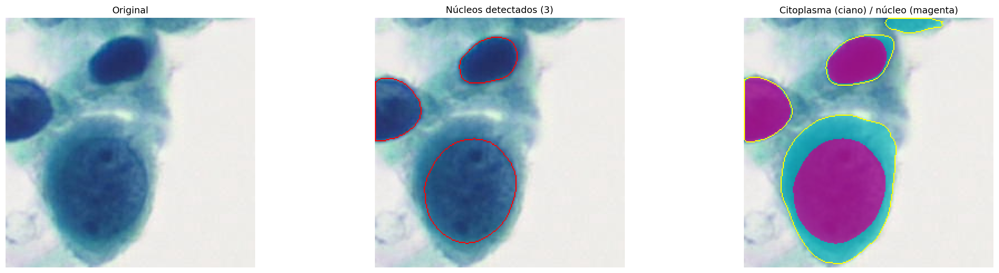

# October — Week 2

## Overview

| # | Activity | Output | Hours |
|---|---|---|---|
| 1 | Highest-scored patches (ABMIL attention) on BMT images | [BMT_attention.ipynb](BMT_attention.ipynb) | 10 h |
| 2 | Nucleus/cell segmentation with Cellpose on a sample patch | [segmentation.ipynb](segmentation.ipynb) | 4 h |
| 3 | N/C ratio distribution per class on all highest-scored patches | [BMT_ratios.ipynb](BMT_ratios.ipynb) | 8 h |

---

### 1. Highest-scored patches on BMT — 10 h

Retrieve, for each BMT image, the **patch that received the highest attention score** from the ABMIL trained in [October — Week 1](../Week%201/README.md).

**Model:** ABMIL over UniCAS embeddings (checkpoint from Week 1), with the `forward` changed to return `argmax` of the attention weights instead of the logits.

**Data:** the UniCAS embeddings of all **600 BMT images** (200 per class).

**Output:** the index of the highest-scored tile per image, used to cut that `224 × 224` patch from the original image (same grid as the extraction) and save it per class (`NIL` / `LSIL` / `HSIL`).

### 2. Segmentation with Cellpose — 4 h

Experiment on a **sample** of the highest-scored patches (one `HSIL` patch).

**Models:** **Cellpose**

- `cyto3` → cell masks
- `nuclei` (`invert=True`) → nucleus masks

**Result:** 4 cells, 3 nuclei, 3 cells with nucleus — ratios `0.79`, `0.94`, `0.56`.

### 3. N/C ratios on all highest-scored patches — 8 h

The same segmentation applied to **all 600 highest-scored patches**, to see how the N/C ratio distribution behaves per class (ratios `≥ 0.95` are discarded (bad segmentation)).

**Result:**

| Class | Cells (n) | Mean | Median | Min | Max |
|---|---|---|---|---|---|
| NIL | 331 | 0.397 | 0.291 | 0.040 | 0.949 |
| LSIL | 93 | 0.833 | 0.902 | 0.092 | 0.949 |
| HSIL | 242 | 0.804 | 0.857 | 0.191 | 0.949 |

- **NIL** is clearly separated, concentrated at low ratios (median `0.29`)
- **LSIL** and **HSIL** both pile up near `0.9`

 
 

**Problem:** the patch is a fixed `224 × 224` grid crop, and the abnormal cells it contains are large, so their **cytoplasm is cut off** at the patch border or disappears from the patch. Thus that, the cell mask ends up close to the nucleus, and the ratio saturates near 1 for every atypical class. Finally, segmenting on the **full-sized image**, where the whole cell is visible, would be better to measure it.
