# October — Week 3


## Overview

| # | Activity | Output | Hours |
|---|---|---|---|
| 1 | Inference on in-house `.kfb` slides — ABMIL (BMT) with top-k aggregation | [kfb_inference.ipynb](kfb_inference.ipynb) | 15 h |

---

### 1. Inference on in-house slides — 15 h

#### Pipeline

```text
WSI (.kfb)
   ↓
Tile extraction (extract_tiles)
   ↓
UniCAS embeddings of each tile  [N × 1024]
   ↓
ABMIL over the embeddings
   ↓
WSI classification by aggregation of the top-k tiles (k = 8)
```

#### ABMIL output

- **Slide logits** `[1, 3]` → `NIL` / `LSIL` / `HSIL` classification of the WSI
- **Top-k indices** `[8]` → which tiles were selected by the attention
- **Attention scores** `[1, 8, 1]` → softmax over the top-k tiles only
- **Tile logits** `[1, 8, 3]` → `classifier` applied to each top-k tile

#### Top-k tiles

`{id}_{x}_{y}.png`: `5503_74816_37632.png` is tile **5503** of the slide (`0` is the first tile), at coordinate **x = 74816, y = 37632**.

**2024-10-14_08_20_41CYT**

| 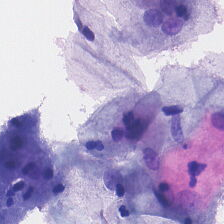 | 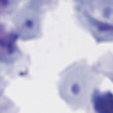 | 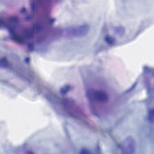 | 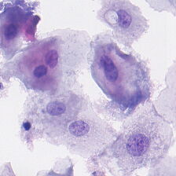 |
|---|---|---|---|
| 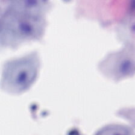 | 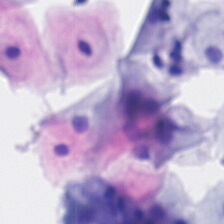 | 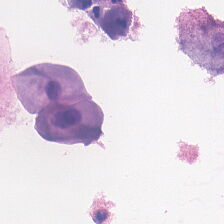 | 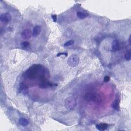 |

**2024-10-14_08_23_14CYT**

| 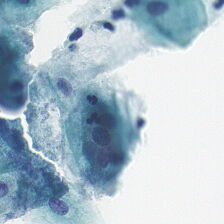 | 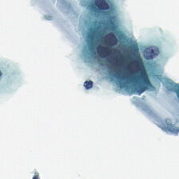 | 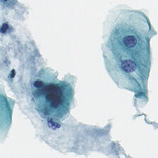 | 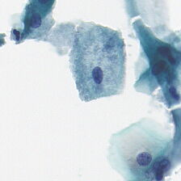 |
|---|---|---|---|
| 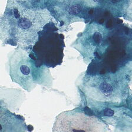 | 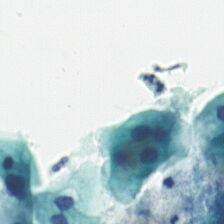 | 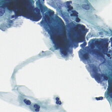 | 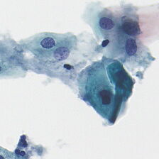 |

**2024-10-14_08_26_04CYT**

| 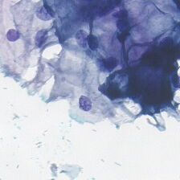 | 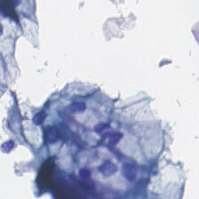 | 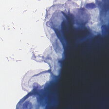 | 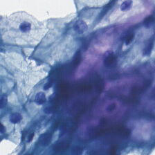 |
|---|---|---|---|
| 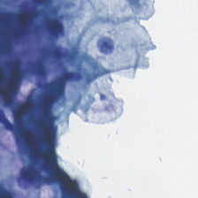 | 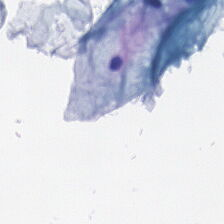 | 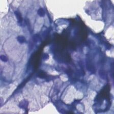 | 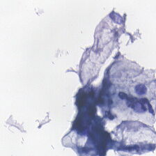 |

**2024-10-14_08_29_15CYT**

| 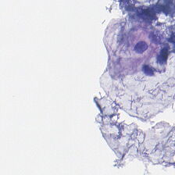 | 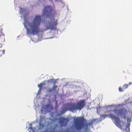 | 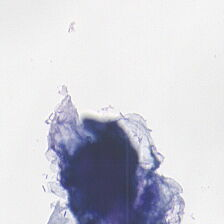 | 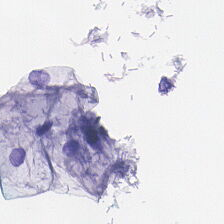 |
|---|---|---|---|
| 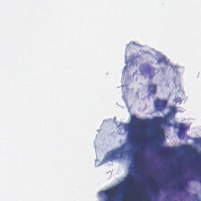 | 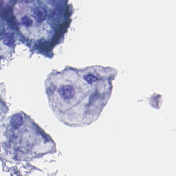 | 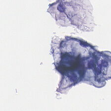 | 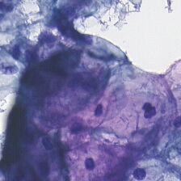 |

**2024-10-14_08_32_03CYT**

| 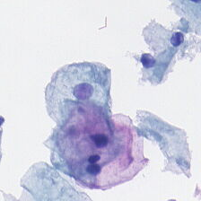 | 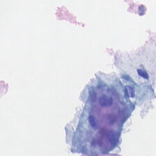 | 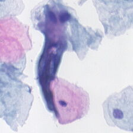 | 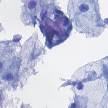 |
|---|---|---|---|
| 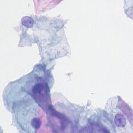 | 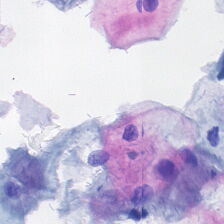 | 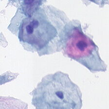 | 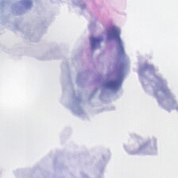 |

**2024-10-14_08_34_52CYT**

| 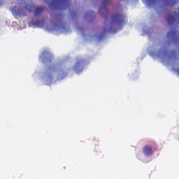 |  | 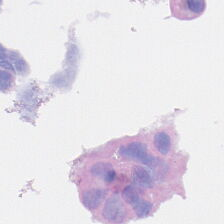 | 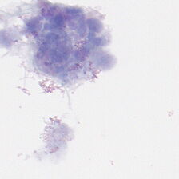 |
|---|---|---|---|
| 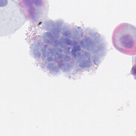 |  | 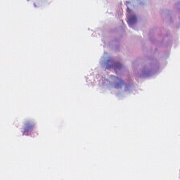 | 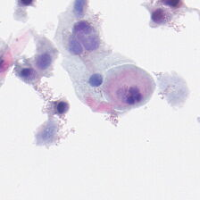 |

**2024-10-14_08_37_27CYT**

| 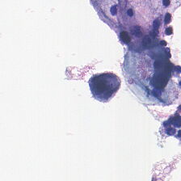 |  | 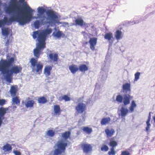 |  |
|---|---|---|---|
| 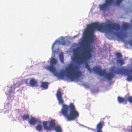 | 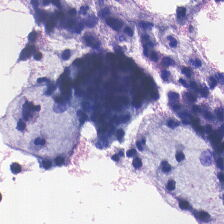 |  |  |

**2024-10-14_08_40_20CYT**

|  |  |  |  |
|---|---|---|---|
|  |  |  |  |

#### Results

| Slide | Classification |
|---|---|
| 2024-10-14_08_20_41CYT | **HSIL** |
| 2024-10-14_08_23_14CYT | **LSIL** |
| 2024-10-14_08_26_04CYT | **LSIL** |
| 2024-10-14_08_29_15CYT | **LSIL** |
| 2024-10-14_08_32_03CYT | **LSIL** |
| 2024-10-14_08_34_52CYT | **HSIL** |
| 2024-10-14_08_37_27CYT | **LSIL** |
| 2024-10-14_08_40_20CYT | **LSIL** |

<details>
<summary><b>2024-10-14_08_20_41CYT</b></summary>

| # | Tile | Attention | Logit NIL | Logit LSIL | Logit HSIL |
|---|---|---|---|---|---|
| 1 | 5503 | 0.126 | -8.226 | 4.949 | -3.099 |
| 2 | 7746 | 0.126 | -11.063 | 0.261 | 3.938 |
| 3 | 8318 | 0.126 | -10.812 | 1.085 | 3.348 |
| 4 | 8063 | 0.125 | -10.849 | -0.989 | 5.245 |
| 5 | 6932 | 0.125 | -9.574 | 0.659 | 3.101 |
| 6 | 7801 | 0.124 | -10.455 | 1.198 | 4.281 |
| 7 | 5902 | 0.124 | -9.839 | 2.056 | 1.387 |
| 8 | 2091 | 0.124 | -8.768 | 4.691 | -0.360 |

</details>

<details>
<summary><b>2024-10-14_08_23_14CYT</b></summary>

| # | Tile | Attention | Logit NIL | Logit LSIL | Logit HSIL |
|---|---|---|---|---|---|
| 1 | 3451 | 0.125 | -12.601 | 9.247 | -5.564 |
| 2 | 3194 | 0.125 | -14.391 | 10.113 | -3.980 |
| 3 | 2117 | 0.125 | -13.535 | 9.725 | -5.149 |
| 4 | 3972 | 0.125 | -11.911 | 5.841 | -2.637 |
| 5 | 2327 | 0.125 | -13.093 | 7.262 | -1.424 |
| 6 | 2 | 0.125 | -13.739 | 2.692 | 1.624 |
| 7 | 3323 | 0.125 | -10.942 | 7.862 | -4.927 |
| 8 | 2983 | 0.125 | -10.985 | 5.871 | -1.497 |

</details>

<details>
<summary><b>2024-10-14_08_26_04CYT</b></summary>

| # | Tile | Attention | Logit NIL | Logit LSIL | Logit HSIL |
|---|---|---|---|---|---|
| 1 | 3385 | 0.126 | -10.827 | 7.349 | -2.679 |
| 2 | 329 | 0.126 | -11.702 | 4.019 | 0.678 |
| 3 | 2417 | 0.125 | -10.924 | 6.799 | -1.438 |
| 4 | 4235 | 0.125 | -12.690 | 4.917 | 1.394 |
| 5 | 884 | 0.125 | -9.820 | 5.246 | -0.748 |
| 6 | 2600 | 0.125 | -7.876 | 5.234 | -3.905 |
| 7 | 754 | 0.124 | -11.124 | 5.943 | -0.791 |
| 8 | 3364 | 0.124 | -8.672 | 6.102 | -2.845 |

</details>

<details>
<summary><b>2024-10-14_08_29_15CYT</b></summary>

| # | Tile | Attention | Logit NIL | Logit LSIL | Logit HSIL |
|---|---|---|---|---|---|
| 1 | 1196 | 0.126 | -12.816 | 4.394 | 0.155 |
| 2 | 68 | 0.126 | -13.893 | 5.560 | -0.257 |
| 3 | 70 | 0.125 | -10.850 | 8.226 | -3.587 |
| 4 | 1365 | 0.125 | -9.120 | 4.297 | -1.230 |
| 5 | 1931 | 0.125 | -11.129 | 8.296 | -2.593 |
| 6 | 1786 | 0.125 | -10.187 | 2.508 | -0.105 |
| 7 | 293 | 0.124 | -9.377 | 3.606 | -0.651 |
| 8 | 306 | 0.124 | -12.835 | 4.993 | 2.234 |

</details>

<details>
<summary><b>2024-10-14_08_32_03CYT</b></summary>

| # | Tile | Attention | Logit NIL | Logit LSIL | Logit HSIL |
|---|---|---|---|---|---|
| 1 | 5172 | 0.126 | -9.914 | 7.426 | -5.489 |
| 2 | 8693 | 0.126 | -9.627 | 3.555 | -1.478 |
| 3 | 7897 | 0.126 | -10.329 | 1.684 | 1.533 |
| 4 | 13221 | 0.125 | -11.786 | 3.296 | 2.009 |
| 5 | 17532 | 0.125 | -8.150 | 4.040 | -1.204 |
| 6 | 14935 | 0.124 | -8.190 | 1.941 | 0.182 |
| 7 | 8254 | 0.124 | -7.540 | 3.249 | -2.785 |
| 8 | 16179 | 0.123 | -8.655 | 1.478 | 1.441 |

</details>

<details>
<summary><b>2024-10-14_08_34_52CYT</b></summary>

| # | Tile | Attention | Logit NIL | Logit LSIL | Logit HSIL |
|---|---|---|---|---|---|
| 1 | 4306 | 0.131 | -12.638 | 1.237 | 4.031 |
| 2 | 3704 | 0.127 | -11.752 | -3.283 | 6.799 |
| 3 | 1970 | 0.126 | -8.503 | 0.929 | 2.325 |
| 4 | 1745 | 0.126 | -7.806 | -1.898 | 3.530 |
| 5 | 1743 | 0.124 | -8.527 | -1.778 | 3.977 |
| 6 | 3481 | 0.124 | -9.540 | -3.593 | 6.497 |
| 7 | 4207 | 0.121 | -7.779 | -2.859 | 4.689 |
| 8 | 3663 | 0.121 | -8.490 | -0.989 | 3.983 |

</details>

<details>
<summary><b>2024-10-14_08_37_27CYT</b></summary>

| # | Tile | Attention | Logit NIL | Logit LSIL | Logit HSIL |
|---|---|---|---|---|---|
| 1 | 416 | 0.126 | -14.675 | 3.183 | 3.387 |
| 2 | 1167 | 0.125 | -9.338 | 6.012 | -2.816 |
| 3 | 1871 | 0.125 | -8.882 | 7.159 | -4.287 |
| 4 | 209 | 0.125 | -10.367 | 8.070 | -3.611 |
| 5 | 780 | 0.125 | -8.574 | 5.756 | -1.784 |
| 6 | 1236 | 0.125 | -8.517 | 6.846 | -4.169 |
| 7 | 153 | 0.125 | -8.740 | 7.762 | -4.545 |
| 8 | 1600 | 0.124 | -9.923 | 5.728 | -1.299 |

</details>

<details>
<summary><b>2024-10-14_08_40_20CYT</b></summary>

| # | Tile | Attention | Logit NIL | Logit LSIL | Logit HSIL |
|---|---|---|---|---|---|
| 1 | 5506 | 0.127 | -11.730 | 6.637 | -1.193 |
| 2 | 407 | 0.126 | -12.846 | 3.523 | 2.557 |
| 3 | 12408 | 0.125 | -13.121 | 0.973 | 5.007 |
| 4 | 11720 | 0.125 | -8.832 | 3.748 | -1.141 |
| 5 | 7105 | 0.125 | -10.545 | 2.877 | 2.264 |
| 6 | 14253 | 0.125 | -12.045 | -0.421 | 5.826 |
| 7 | 8838 | 0.125 | -7.141 | 3.909 | -2.807 |
| 8 | 13566 | 0.124 | -10.347 | -0.386 | 5.113 |

</details>
