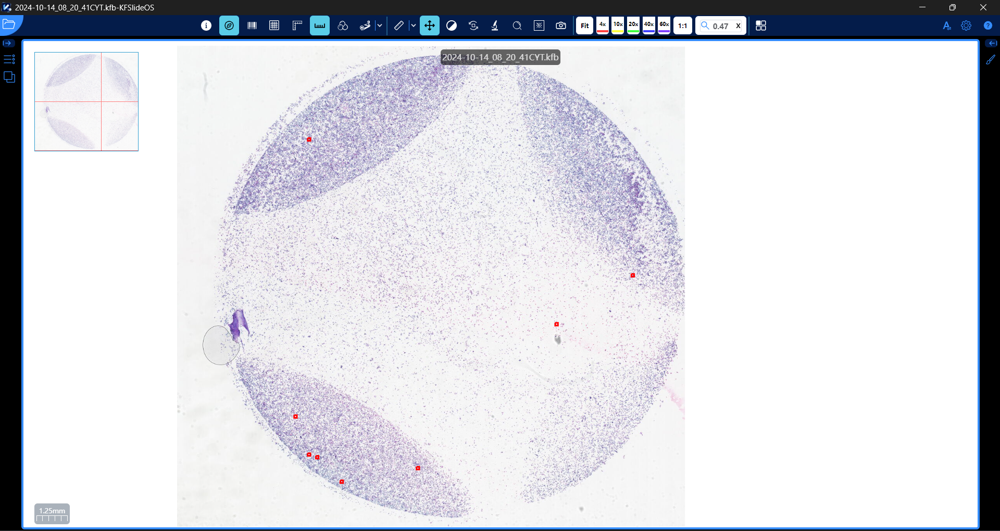
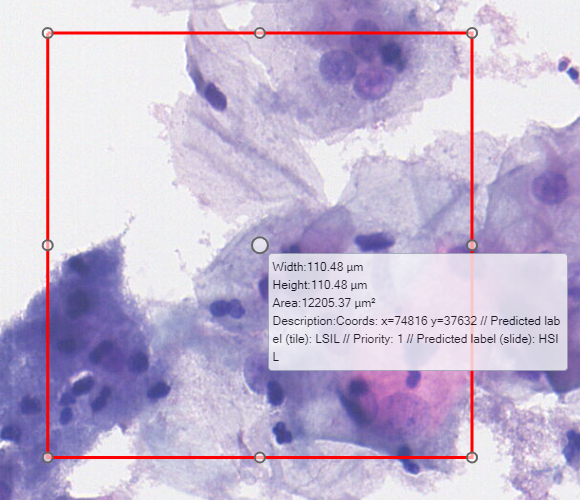
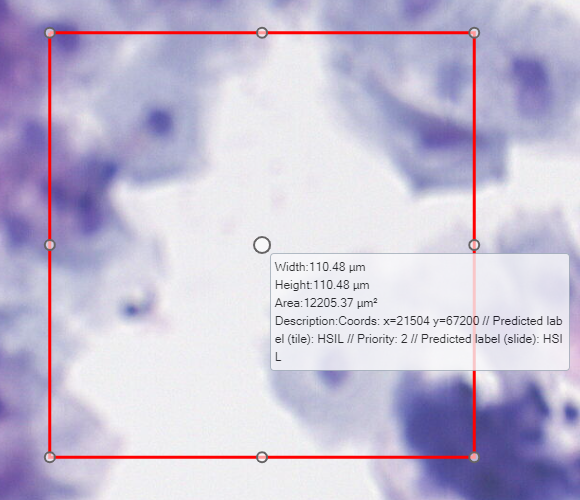
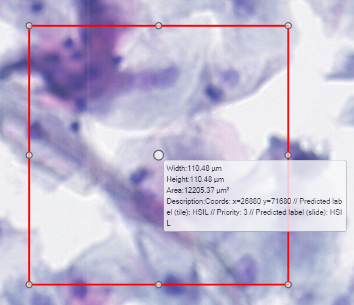
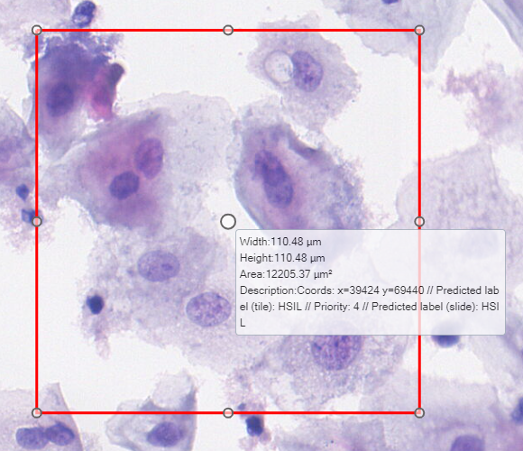
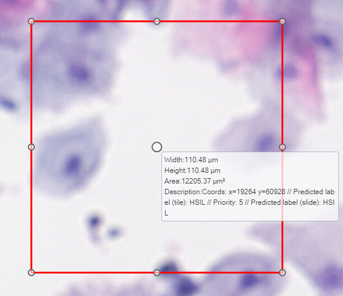
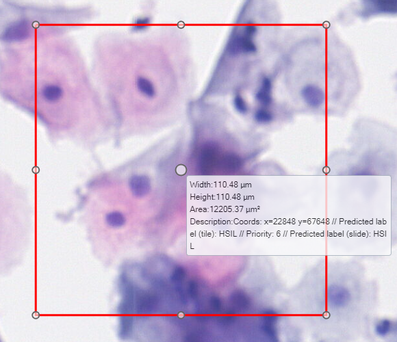
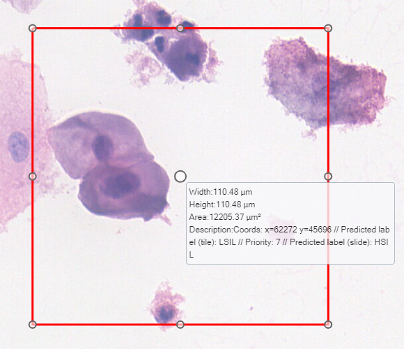
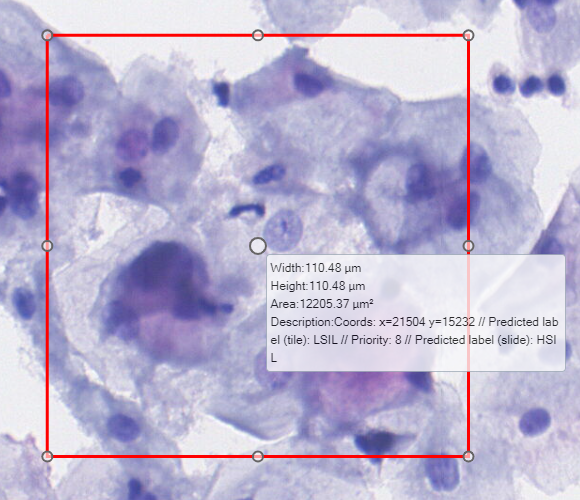

# October — Week 4


## Overview

| # | Activity | Output | Hours |
|---|---|---|---|
| 1 | Top-k tiles as annotations in KFSlideOS | [kfb_inference.ipynb](kfb_inference.ipynb) | 3 h |
| 2 | Distribution of the attention scores (WSI and NIL BMT) | [attention_scores_analysis.ipynb](attention_scores_analysis.ipynb) | 3 h |
| 3 | Top-k behaviour on NIL BMT images | [NIL_topk_old_abmil.ipynb](NIL_topk_old_abmil.ipynb) | 2 h |

---

### 1. Top-k tiles in KFSlideOS — 3 h

Same notebook as [October — Week 3](../Week%203/README.md), with an extra cell that writes a `.json` with the regions of the top-k suspicious tiles, to visualize them in **KFSlideOS**.

**Folder structure** (the folder must be next to the `.kfb`, named after it):

```text
<folder>/
├── 2024-10-14_08_20_41CYT.kfb
└── 2024-10-14_08_20_41CYT_kfb/
    └── Annotations/
        └── 1.json
```

**General view**



**Top-k suspicious tiles**

|  |  |  |  |
|---|---|---|---|
|  |  |  |  |

### 2. Attention scores distribution — 3 h

Histograms and ranges of the attention scores (pre-softmax) on the WSI (`2024-10-14_08_20_41CYT`) and on the NIL BMT images.

**WSI (8,798 tiles):**

| Score | Tiles |
|---|---|
| `-1 ≤ x < 0` | 4.6% (408) |
| `0 ≤ x < 1` | 30.3% (2,664) |
| `1 ≤ x < 2` | 27.7% (2,433) |
| `2 ≤ x < 3` | 16.5% (1,455) |
| `3 ≤ x < 4` | 14.1% (1,239) |
| `4 ≤ x < 5` | 6.8% (599) |

- Many tiles have high scores, not only the best 8: **599 tiles** have a score `≥ 4`, so top-k = 8 is picked among hundreds of almost tied tiles and does not select well

**NIL BMT:**

- Most tiles are below `1` (73–97% depending on the image)
- High scores are rare: a few images have one or two tiles above `2`–`4`, and those are the tiles a small top-k picks

### 3. Top-k on NIL BMT images — 2 h

The **top-k suspicious tiles** could bias a NIL image towards `LSIL` or `HSIL`, so the ABMIL was run on the **200 NIL BMT images** varying `k`:

| top-k | 1 | 2 | 4 | 8 | 16 | 32 | all (`-1`) |
|---|---|---|---|---|---|---|---|
| NIL hits | 93/200 | 111/200 | 141/200 | 156/200 | 173/200 | 190/200 | **194/200** |

- It is possible to classify NIL with top-k, but the smaller `k`, the more errors
- The best result was weighting **all tiles** (`k = -1`), probably because this ABMIL was trained without top-k (all tiles in the weighted sum)

---

**IMPORTANT**

The ABMIL used in this week was **trained without top-k**, so the top-k results above are not reliable: top-k was applied only at inference, on a model that never learned to classify from a subset of tiles.

**Next step:** retrain the ABMIL on BMT **with top-k inside the `forward`** (choosing `k` on validation) and repeat the analysis (NIL BMT images and the in-house WSIs) with the new model.
