# November — Week 1


## Overview

| # | Activity | Output | Hours |
|---|---|---|---|
| 1 | ABMIL retrained with top-k selected by attention | [abmil_topk_attention.ipynb](abmil_topk_attention.ipynb) | 5 h |
| 2 | ABMIL retrained with top-k selected by tile logits | [abmil_topk.ipynb](abmil_topk.ipynb) | 10 h |
| 3 | Inference on in-house `.kfb` slides with the ABMIL top-k | [kfb_inference.ipynb](kfb_inference.ipynb) | 5 h |

---

The top-k pipeline at the end of [October](../../03-October/Week%204/README.md) was wrong: the architecture was adapted to aggregate only the top-k tiles by **attention score**, but it used the ABMIL trained aggregating all tiles with attention.

`abmil_topk_attention.ipynb` was written to train the ABMIL already with top-k, but, in the end, the top-k was chosen by the **tile logits** instead of the attention scores (`abmil_topk.ipynb`), following the approach of [Stegmüller et al.](../../01-August/Week%202/Paper-Stegmuller.md)

### 1. ABMIL top-k — 15 h

#### Architecture (ABMIL top-k)

Gated attention over the top-k tiles:

- `proj` → `Linear(1024, 256)` + ReLU + Dropout(0.25)
- `classifier` applied to **each tile** → tile logits `[N, 3]` → selection of the **top-k tiles** (`k = 8`)
- `att_V` → `Linear(256, 128)` + Tanh (top-k tiles only)
- `att_U` → `Linear(256, 128)` + Sigmoid (top-k tiles only)
- `att_w` → `Linear(128, 1)`, softmax over the top-k tiles
- `classifier` → `Linear(256, 3)` on the bag embedding

#### 1.1 Choice of k

10 trainings for each `k ∈ {1, 2, 4, 8, 16, 32, all}`, taking the mean of the best validation loss:

| k | 1 | 2 | 4 | 8 | 16 | 32 | all (`-1`) |
|---|---|---|---|---|---|---|---|
| Best val. loss (mean) | 0.311 | 0.226 | 0.185 | 0.143 | 0.151 | 0.132 | 0.122 |

- From `k = 8` on, the values oscillate little (`0.122`–`0.151`): the differences are smaller than the variation between single trainings
- Many more runs (e.g. 100) could separate them, but would take too long, so **`k = 8`** was chosen because it is the smallest value of this plateau, and the one used by Stegmüller et al

#### 1.2 Choice of the top-k suspicious tiles

The `classifier` is applied to each tile, and its logits go through a softmax. Each tile gets the score:

```text
score = (P(LSIL) + P(HSIL)) / P(NIL)
```

The `k` tiles with the highest score are the **top-k suspicious tiles**, which go to the attention.

#### 1.3 Results (topk=8)

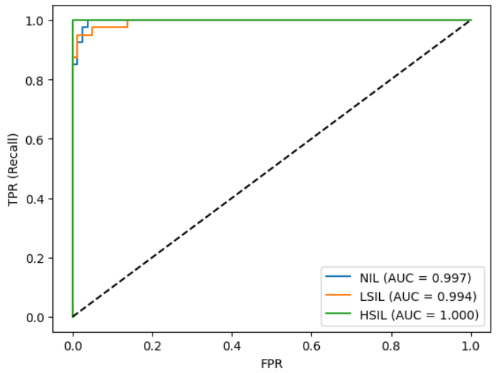

### 2. Inference on in-house slides — 5 h

#### Pipeline

```text
WSI (.kfb)
   ↓
Tile extraction (extract_tiles)
   ↓
UniCAS embeddings of each tile  [N × 1024]
   ↓
ABMIL top-k (top-k tiles by logits, k = 8)
   ↓
WSI classification
   ↓
JSON with the top-k tiles as KFSlideOS annotations
```

#### ABMIL output

- **Slide logits** `[1, 3]` → `NIL` / `LSIL` / `HSIL` classification of the WSI
- **Tile logits** `[1, 8, 3]` → logits of each top-k tile
- **Top-k indices** `[8]` → which tiles were selected

#### Top-k tiles

**2024-10-14_08_20_41CYT**

| 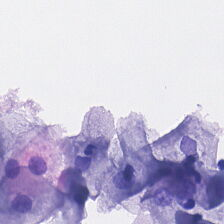 | 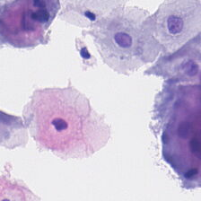 | 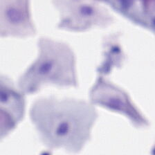 | 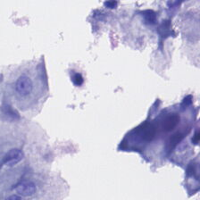 |
|---|---|---|---|
| 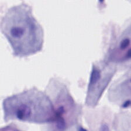 | 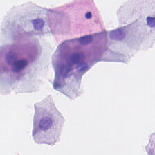 | 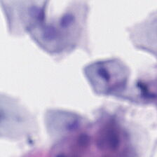 | 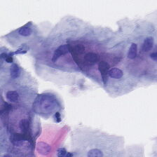 |

**2024-10-14_08_23_14CYT**

| 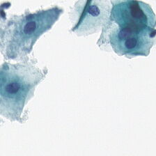 | 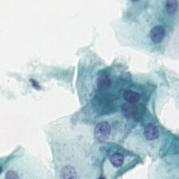 | 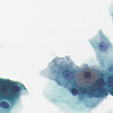 |  |
|---|---|---|---|
| 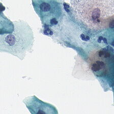 | 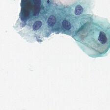 | 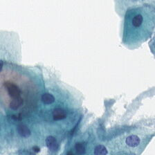 | 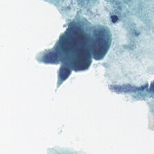 |

**2024-10-14_08_26_04CYT**

| 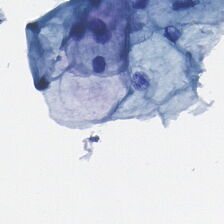 | 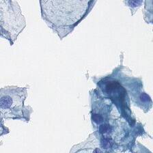 | 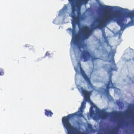 | 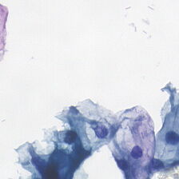 |
|---|---|---|---|
| 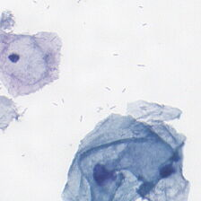 |  | 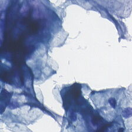 | 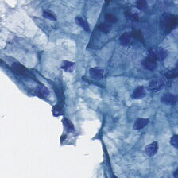 |

**2024-10-14_08_29_15CYT**

| 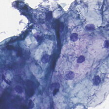 | 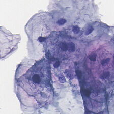 | 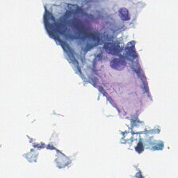 | 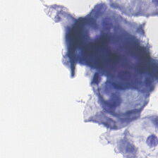 |
|---|---|---|---|
| 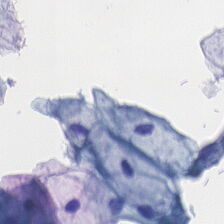 | 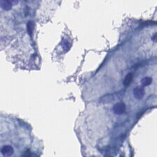 | 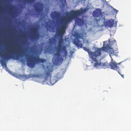 | 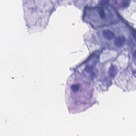 |

**2024-10-14_08_32_03CYT**

| 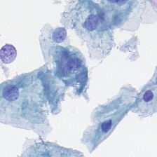 | 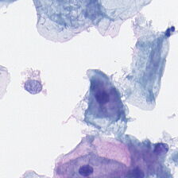 | 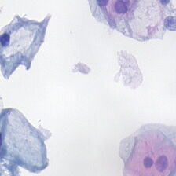 | 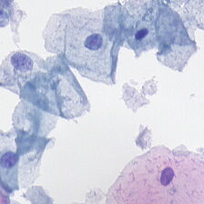 |
|---|---|---|---|
| 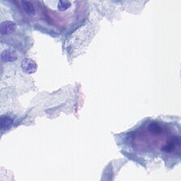 | 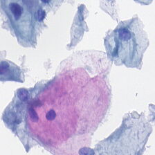 | 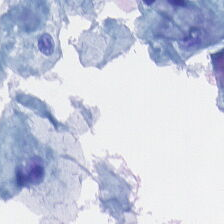 | 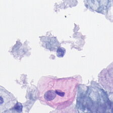 |

**2024-10-14_08_34_52CYT**

| 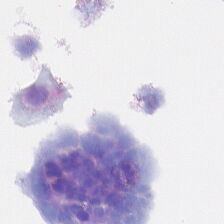 |  | 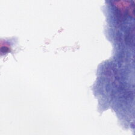 | 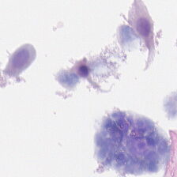 |
|---|---|---|---|
| 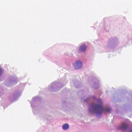 | 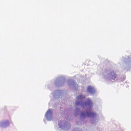 | 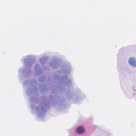 | 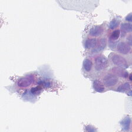 |

**2024-10-14_08_37_27CYT**

| 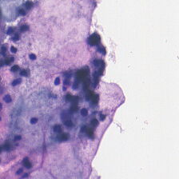 | 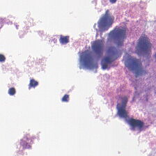 | 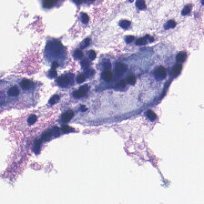 | 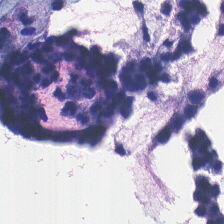 |
|---|---|---|---|
|  |  |  |  |

**2024-10-14_08_40_20CYT**

|  |  |  |  |
|---|---|---|---|
|  |  |  |  |

#### Results

| Slide | Classification |
|---|---|
| 2024-10-14_08_20_41CYT | **HSIL** |
| 2024-10-14_08_23_14CYT | **HSIL** |
| 2024-10-14_08_26_04CYT | **HSIL** |
| 2024-10-14_08_29_15CYT | **LSIL** |
| 2024-10-14_08_32_03CYT | **HSIL** |
| 2024-10-14_08_34_52CYT | **HSIL** |
| 2024-10-14_08_37_27CYT | **LSIL** |
| 2024-10-14_08_40_20CYT | **HSIL** |

<details>
<summary><b>2024-10-14_08_20_41CYT</b> — HSIL</summary>

| # | Tile | Logit NIL | Logit LSIL | Logit HSIL |
|---|---|---|---|---|
| 1 | 3933 | -14.819 | -2.723 | 12.942 |
| 2 | 7293 | -13.153 | -8.582 | 15.682 |
| 3 | 6198 | -13.205 | -6.979 | 15.662 |
| 4 | 4196 | -12.655 | -9.380 | 17.582 |
| 5 | 7237 | -14.212 | -5.183 | 13.738 |
| 6 | 8184 | -14.979 | -1.867 | 12.974 |
| 7 | 7271 | -16.518 | -3.415 | 15.485 |
| 8 | 4520 | -14.089 | -8.149 | 16.046 |

</details>

<details>
<summary><b>2024-10-14_08_23_14CYT</b> — HSIL</summary>

| # | Tile | Logit NIL | Logit LSIL | Logit HSIL |
|---|---|---|---|---|
| 1 | 3602 | -21.225 | -1.497 | 15.518 |
| 2 | 10 | -16.555 | -3.585 | 13.718 |
| 3 | 3661 | -24.780 | 4.582 | 12.813 |
| 4 | 3194 | -26.984 | 15.620 | 2.278 |
| 5 | 2359 | -17.343 | 10.658 | 0.159 |
| 6 | 1983 | -25.226 | 13.053 | 3.429 |
| 7 | 1224 | -17.030 | -1.206 | 10.639 |
| 8 | 709 | -13.211 | -7.596 | 14.842 |

</details>

<details>
<summary><b>2024-10-14_08_26_04CYT</b> — HSIL</summary>

| # | Tile | Logit NIL | Logit LSIL | Logit HSIL |
|---|---|---|---|---|
| 1 | 2978 | -17.379 | 10.917 | -2.229 |
| 2 | 3371 | -14.152 | -7.821 | 16.371 |
| 3 | 3875 | -15.477 | 0.086 | 12.376 |
| 4 | 3787 | -14.233 | -4.308 | 13.370 |
| 5 | 3610 | -16.957 | 0.700 | 10.600 |
| 6 | 2600 | -17.267 | 9.894 | -0.113 |
| 7 | 2695 | -15.376 | -2.376 | 11.639 |
| 8 | 3131 | -15.578 | 11.355 | -1.643 |

</details>

<details>
<summary><b>2024-10-14_08_29_15CYT</b> — LSIL</summary>

| # | Tile | Logit NIL | Logit LSIL | Logit HSIL |
|---|---|---|---|---|
| 1 | 1750 | -16.323 | 12.787 | -3.193 |
| 2 | 382 | -14.802 | 13.630 | -4.733 |
| 3 | 1945 | -14.800 | 12.292 | -4.722 |
| 4 | 311 | -12.831 | -3.420 | 13.007 |
| 5 | 767 | -12.479 | -3.802 | 13.137 |
| 6 | 751 | -14.818 | -0.188 | 10.784 |
| 7 | 1762 | -18.385 | 6.994 | 3.175 |
| 8 | 191 | -13.129 | -3.368 | 12.047 |

</details>

<details>
<summary><b>2024-10-14_08_32_03CYT</b> — HSIL</summary>

| # | Tile | Logit NIL | Logit LSIL | Logit HSIL |
|---|---|---|---|---|
| 1 | 3796 | -15.600 | -6.934 | 15.635 |
| 2 | 5453 | -17.964 | -3.342 | 16.759 |
| 3 | 16924 | -21.068 | 4.168 | 9.799 |
| 4 | 15418 | -15.641 | -3.687 | 14.944 |
| 5 | 15082 | -16.207 | -4.870 | 15.520 |
| 6 | 15294 | -21.715 | 11.450 | 3.535 |
| 7 | 6706 | -17.863 | 1.855 | 10.329 |
| 8 | 9853 | -17.723 | -0.156 | 11.844 |

</details>

<details>
<summary><b>2024-10-14_08_34_52CYT</b> — HSIL</summary>

| # | Tile | Logit NIL | Logit LSIL | Logit HSIL |
|---|---|---|---|---|
| 1 | 3704 | -18.306 | -1.373 | 16.601 |
| 2 | 4306 | -18.813 | 0.399 | 11.447 |
| 3 | 3481 | -12.864 | -5.336 | 13.601 |
| 4 | 1290 | -13.404 | -2.761 | 12.546 |
| 5 | 4042 | -14.263 | -0.445 | 10.558 |
| 6 | 1333 | -13.059 | -2.076 | 11.465 |
| 7 | 721 | -13.359 | -1.974 | 11.142 |
| 8 | 2632 | -11.155 | -5.858 | 12.536 |

</details>

<details>
<summary><b>2024-10-14_08_37_27CYT</b> — LSIL</summary>

| # | Tile | Logit NIL | Logit LSIL | Logit HSIL |
|---|---|---|---|---|
| 1 | 1555 | -18.634 | 10.020 | 1.943 |
| 2 | 241 | -16.648 | -2.692 | 14.266 |
| 3 | 1167 | -18.959 | 10.836 | 1.464 |
| 4 | 1514 | -18.915 | 2.660 | 9.286 |
| 5 | 1391 | -21.767 | -12.741 | 26.221 |
| 6 | 209 | -17.344 | 15.583 | -5.392 |
| 7 | 350 | -15.680 | -2.668 | 11.612 |
| 8 | 593 | -14.492 | 12.269 | -7.119 |

</details>

<details>
<summary><b>2024-10-14_08_40_20CYT</b> — HSIL</summary>

| # | Tile | Logit NIL | Logit LSIL | Logit HSIL |
|---|---|---|---|---|
| 1 | 211 | -15.354 | -3.562 | 13.697 |
| 2 | 4794 | -14.012 | -5.723 | 14.621 |
| 3 | 1455 | -15.907 | -5.357 | 15.369 |
| 4 | 2189 | -16.526 | -1.304 | 12.826 |
| 5 | 7434 | -19.157 | -5.442 | 17.469 |
| 6 | 13094 | -13.602 | -8.174 | 15.482 |
| 7 | 10410 | -10.864 | -13.584 | 17.287 |
| 8 | 624 | -16.966 | -6.395 | 15.658 |

</details>
