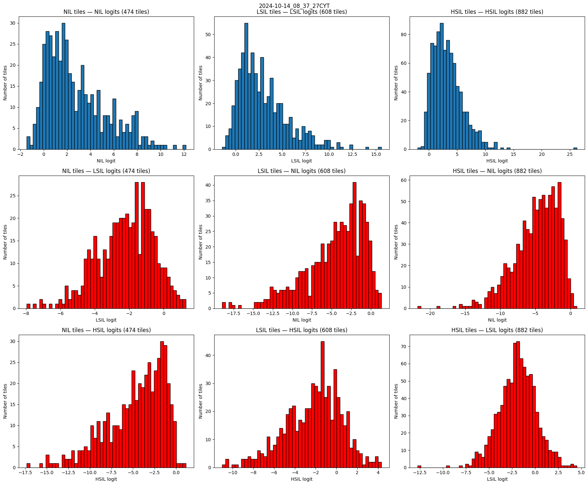
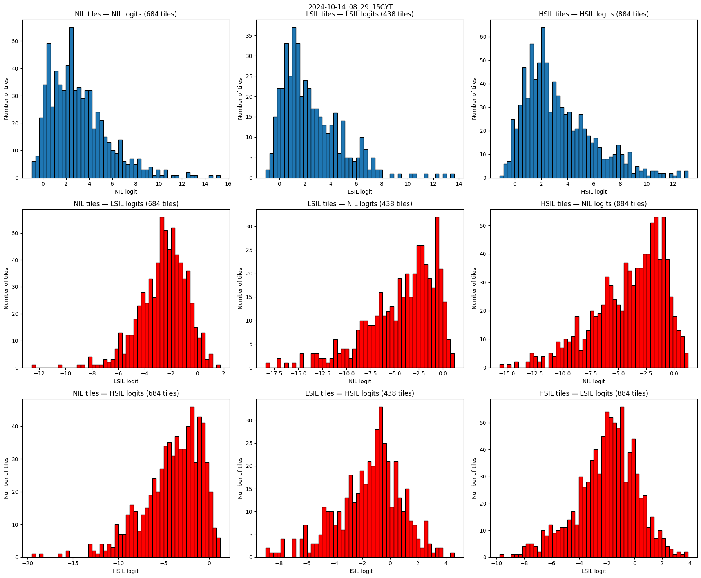
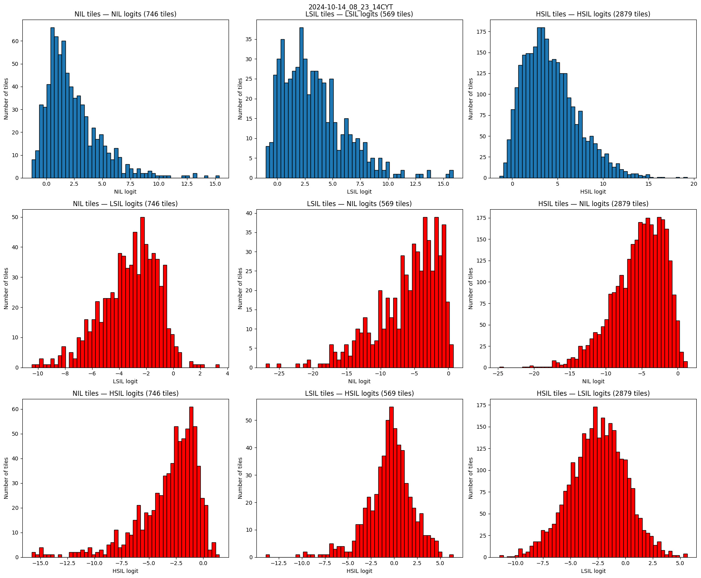
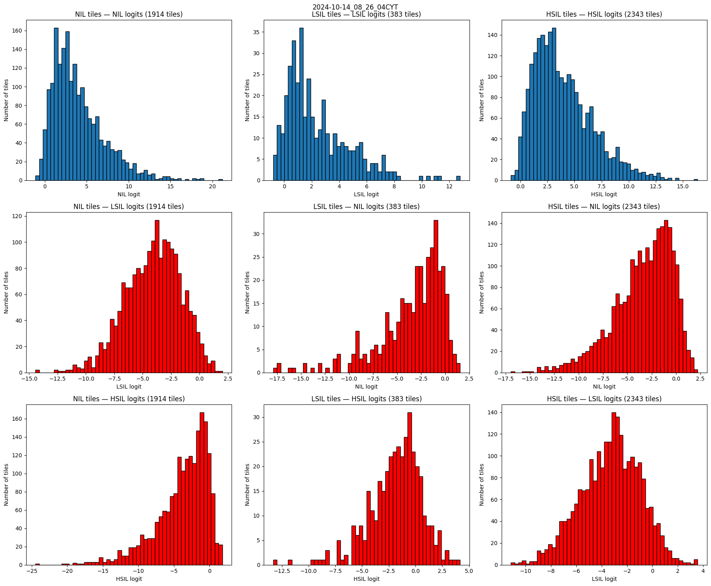
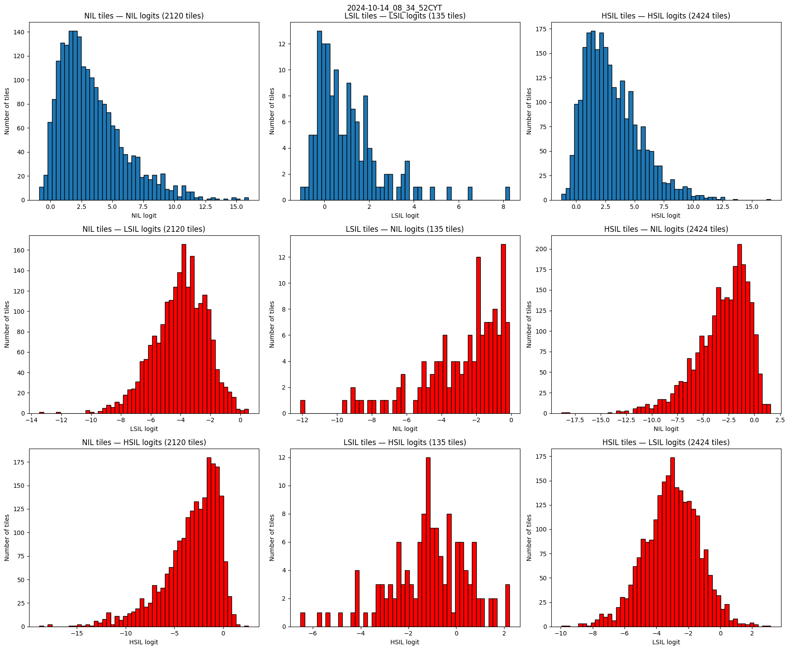
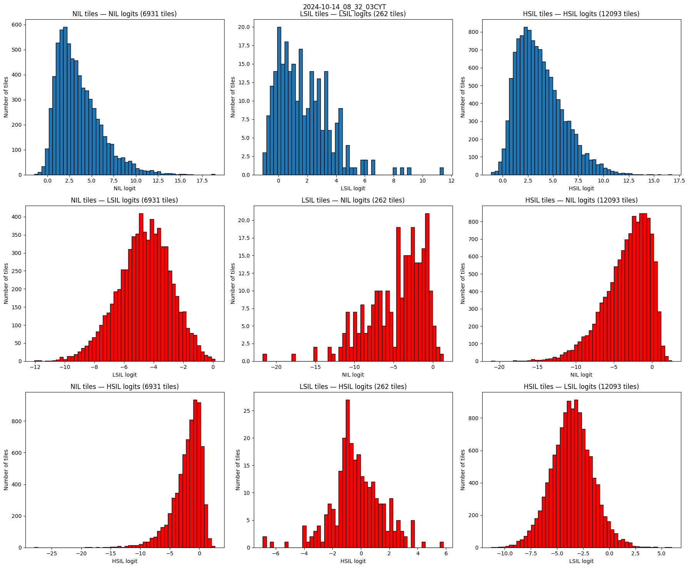
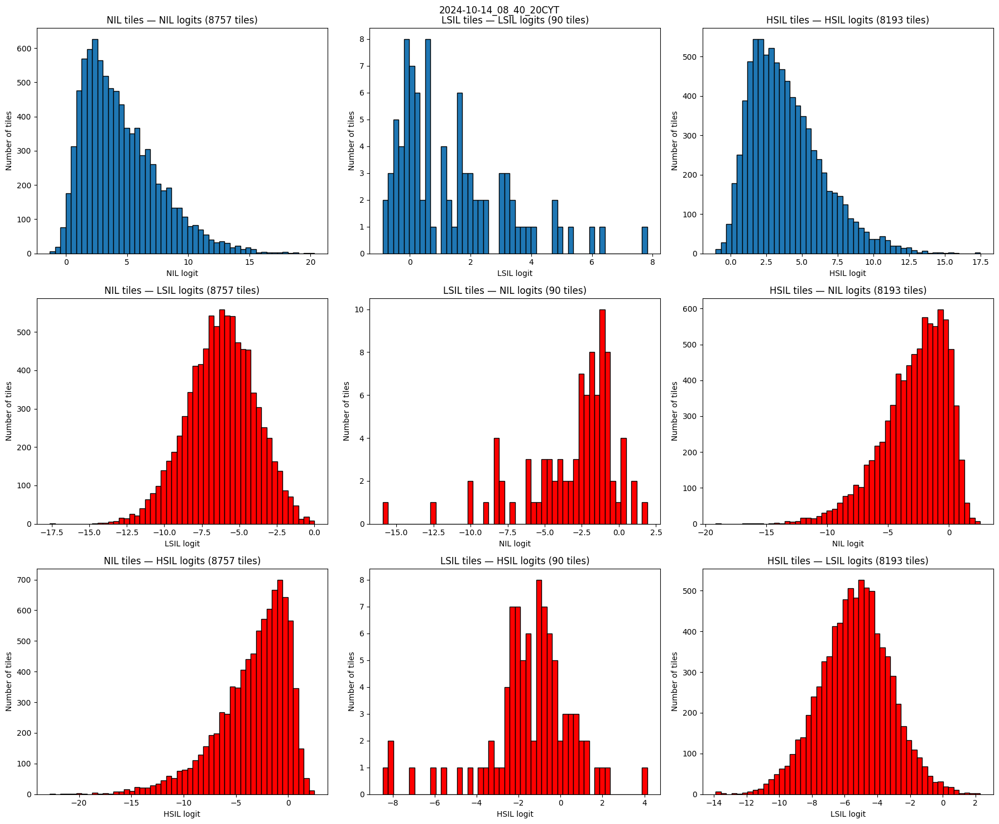
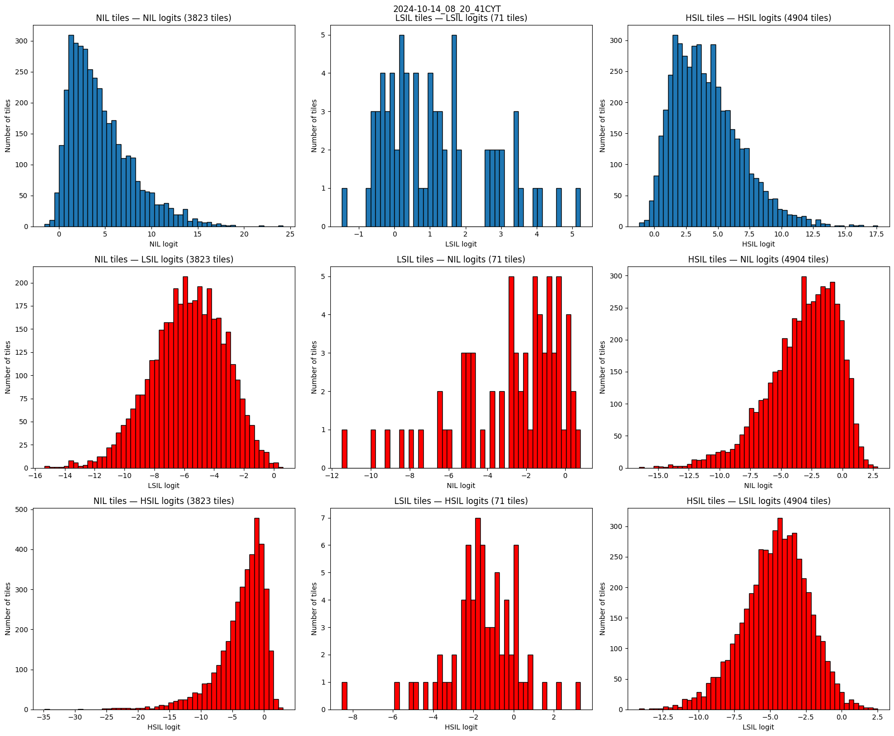

# November — Week 2

## Overview

| # | Activity | Output | Hours |
|---|---|---|---|
| 1 | Meeting with Prof. Michelle Discacciati (Nov 4) | — | 3 h |
| 2 | Scores of all tiles of the in-house `.kfb` slides | [kfb_inference.ipynb](kfb_inference.ipynb) | 3 h |
| 3 | Read of Xue et al. | [Paper-Xue.md](Paper-Xue.md) | 3 h |
| 4 | Read of Jiang & Zheng | [Paper-Jiang.md](Paper-Jiang.md) | 5 h |

---

### 1. Meeting with Prof. Michelle — 3 h

Meeting to resume the discussion about the data and a brief explanation of the classes:

- **Squamous cells:** Normal, ASC-US, ASC-H, LSIL, HSIL
- **Endocervical (glandular) cells:** AGC-NEO and AGC-SOE

There was also the opportunity to see slides in person on a microscope, with her guidance and explanation.

About the data:

- **Volume of slides:** around **300–310** for positive/negative classification ([Stegmüller et al.](https://doi.org/10.1016/j.compbiomed.2023.107809) used 69 positives and 238 negatives). For three classes (Normal / LSIL / HSIL) there is no reference number from another paper, but a good volume could be around **400–420** (e.g. 280 Normal / 70 LSIL / 70 HSIL)
- **Protocol:** all slides should follow the same protocol, with **ThinPrep** being the most adequate, and it is already the one used in the slides seen in the meeting
- **Labels:** each slide with its classification (e.g. positive/negative or Normal/LSIL/HSIL), maybe in an Excel spreadsheet, with a **patient identifier** (a number, not the name) to track slides that belong to the same patient
- **Next week:** ~10 labeled slides to continue exploring them

### 2. Scores of all tiles — 3 h

Analysis of the scores of **all tiles** of each slide (last cells of [kfb_inference.ipynb](kfb_inference.ipynb)), using the ABMIL top-k from [Week 1](../Week%201/README.md). Each tile is assigned to the class with the highest probability (`argmax` of the tile logits).

**2024-10-14_08_37_27CYT** — 1,964 tiles

| NIL | LSIL | HSIL |
|---|---|---|
| 474 (24.13%) | 608 (30.96%) | 882 (44.91%) |

**2024-10-14_08_29_15CYT** — 2,006 tiles

| NIL | LSIL | HSIL |
|---|---|---|
| 684 (34.10%) | 438 (21.83%) | 884 (44.07%) |

**2024-10-14_08_23_14CYT** — 4,194 tiles

| NIL | LSIL | HSIL |
|---|---|---|
| 746 (17.79%) | 569 (13.57%) | 2,879 (68.65%) |

**2024-10-14_08_26_04CYT** — 4,640 tiles

| NIL | LSIL | HSIL |
|---|---|---|
| 1,914 (41.25%) | 383 (8.25%) | 2,343 (50.50%) |

**2024-10-14_08_34_52CYT** — 4,679 tiles

| NIL | LSIL | HSIL |
|---|---|---|
| 2,120 (45.31%) | 135 (2.89%) | 2,424 (51.81%) |

**2024-10-14_08_32_03CYT** — 19,286 tiles

| NIL | LSIL | HSIL |
|---|---|---|
| 6,931 (35.94%) | 262 (1.36%) | 12,093 (62.70%) |

**2024-10-14_08_40_20CYT** — 17,040 tiles

| NIL | LSIL | HSIL |
|---|---|---|
| 8,757 (51.39%) | 90 (0.53%) | 8,193 (48.08%) |

**2024-10-14_08_20_41CYT** — 8,798 tiles

| NIL | LSIL | HSIL |
|---|---|---|
| 3,823 (43.45%) | 71 (0.81%) | 4,904 (55.74%) |

#### Comments

- **Too few NIL tiles:** a much larger fraction of NIL was expected (well above 90%), because even in positive slides the abnormal content is very small, only a few cells among thousands of normal ones. Here NIL is only **18–51%** of the tiles, and HSIL is the majority in almost every slide
- **Likely a consequence of the pipeline:** the ABMIL was trained on the **BMT** dataset and is being evaluated on **WSIs** from another lab, scanner and preparation (domain shift). Besides that, the training on BMT also used tiles from WSIs, but each bag was one 1920 × 1080 crop with a single label for the whole image, so the tile classifier never had a label for each tile. Therefore, the scores of the tiles outside the top-k are not calibrated, and many of them end up as LSIL/HSIL
- **Few LSIL and many HSIL:** LSIL and HSIL are hard to distinguish morphologically, and LSIL is also close to normal/reactive changes, so the model may collapse the abnormal tiles into a single class. It can also be the pipeline again: tiles out of the training distribution seem to be pushed to HSIL, which explains why the larger slides (more tiles, more variability) have almost no LSIL (`0.5–1.4%`) and mostly HSIL
- Without labels for these slides, it is not possible to say which tiles are really abnormal. The labeled slides from Prof. Michelle (including negatives) are needed to validate this analysis

### 3. Read of Xue et al. — 3 h

Read of "[Deep learning enabled liquid-based cytology model for cervical precancer and cancer detection](https://doi.org/10.1038/s41467-025-58883-3)" ([notes](Paper-Xue.md)). Positive/negative classification of LBC WSIs (ThinPrep, SurePath and others, 17,397 slides from 3 scanners) in two stages: a **RetinaNet** detects abnormal cells with ~1 million annotated cells, and the **top-24 detections** go through a crop classifier and a **MIL Transformer** for the slide-level decision, with external validation in several hospitals.

### 4. Read of Jiang & Zheng — 5 h

Read of "[Deep Learning for Cervical Cytology Screening: Methods, Algorithms, Challenges and Prospects](https://arxiv.org/html/2611.01730)" ([notes](Paper-Jiang.md)). A review of what has already been done in deep learning for cervical cytology: public datasets, cell-level methods (segmentation, feature extraction, classification), patch-level methods (instance segmentation, detection), WSI-level methods (aggregation, MIL, graphs), foundation models and the open challenges of the field.
