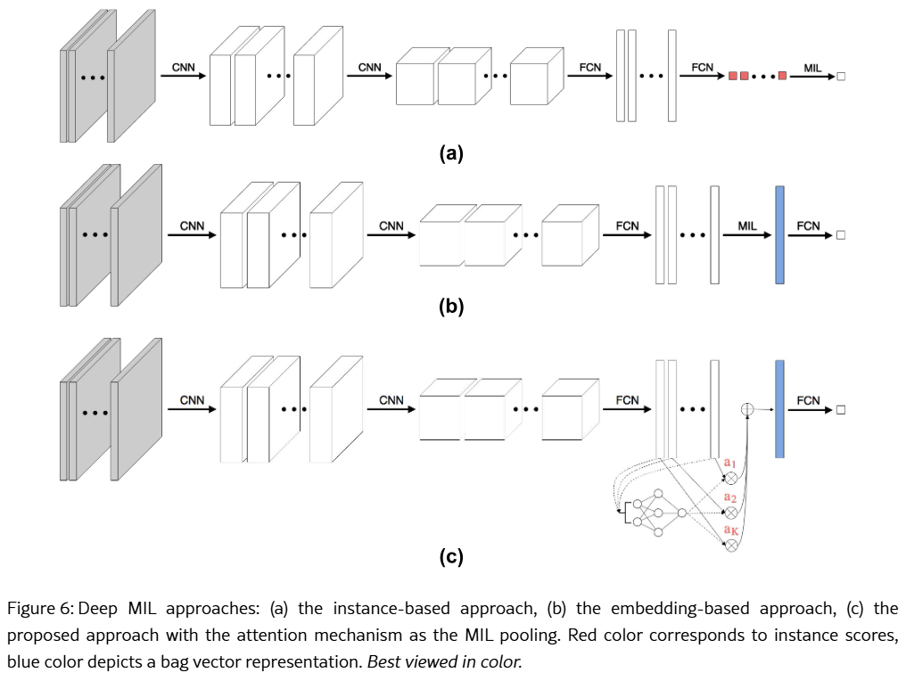

# Paper Notes — Attention-based Deep Multiple Instance Learning

> Ilse, M.; Tomczak, J.M.; Welling, M.
> *ICML* **2018** (PMLR 80). arXiv: [1802.04712](https://arxiv.org/abs/1802.04712)
> University of Amsterdam
> Code: <https://github.com/AMLab-Amsterdam/AttentionDeepMIL>

## 1. MIL problem

A **bag** `X = {x₁, …, x_K}` has a single label `Y`, while the instance labels `y₁, …, y_K` exist but are unknown. The instances have no order or dependency, and `K` can change from bag to bag.

```text
Y = 0  if all y_k = 0
Y = 1  otherwise              →   Y = max_k { y_k }
```

- The model must be **permutation-invariant** (the order of the instances does not matter)
- Training directly on `max` has vanishing gradients, so the bag label is modeled as a **Bernoulli** with parameter `θ(X) = P(Y = 1 | X)` and trained with **log-likelihood** (binary cross-entropy)

Any permutation-invariant bag score can be written as:

```text
S(X) = g( σ_{x ∈ X} f(x) )
```

- `f` → transforms each instance
- `σ` → **MIL pooling**, a permutation-invariant aggregation (sum, mean, max, ...)
- `g` → transforms the aggregated result into `θ(X)`

## 2. Deep MIL approaches



## 3. Attention-based MIL pooling

`max` and `mean` are fixed and not trainable. The proposed pooling is a weighted average of the embeddings `h_k ∈ ℝᴹ`:

```text
z = Σ_k a_k · h_k
```

**Attention**

```text
a_k = softmax_k( wᵀ tanh(V h_k) )            V ∈ ℝ^(L×M),  w ∈ ℝ^(L×1)
```

**Gated attention**

```text
a_k = softmax_k( wᵀ [ tanh(V h_k) ⊙ sigm(U h_k) ] )     U ∈ ℝ^(L×M)
```

- `tanh` allows positive and negative values
- **Gate** (`sigm(U h_k)`) adds a learnable non-linearity (`tanh` is almost linear in `[-1, 1]`)
- `L ∈ {64, 128, 256}` changed the results very little
- In a positive bag, the instances with the highest `a_k` should be the positive ones (key instances), so `a_k` can be used as a **heatmap / ROIs**
- Attention also works as a **gradient filter**: instances with higher weight contribute more to train `f`

#### Attention

- `attention_V`: `Linear(500, 128)` + Tanh → `[K × 128]`
- `attention_w`: `Linear(128, 1)` → `[K × 1]`
- softmax: `A [1 × K]`
- `z = A · H` → `[1 × 500]`

#### Gated attention

- `attention_V`: `Linear(500, 128)` + Tanh → `A_V [K × 128]`
- `attention_U`: `Linear(500, 128)` + Sigmoid → `A_U [K × 128]`
- `A_V ⊙ A_U` (element-wise): `[K × 128]`
- `attention_w`: `Linear(128, 1)` → `[K × 1]`
- softmax: `A [1 × K]`
- `z = A · H` → `[1 × 500]`

## 4. Results

**MNIST-bags:**

- Attention is much better in the **small-data regime** (few bags / few instances per bag)
- Embedding-level > instance-level, and `max` > `mean`

**Histopathology:**

| Method | Breast AUC | Colon AUC |
|---|---|---|
| Instance + max | 0.612 | 0.914 |
| Instance + mean | 0.719 | 0.866 |
| Embedding + max | 0.650 | 0.918 |
| Embedding + mean | 0.796 | 0.940 |
| Attention | 0.775 | **0.968** |
| Gated-Attention | **0.799** | **0.968** |